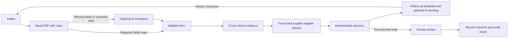

# VendorFlow

VendorFlow turns a vendor application and two supporting PDFs into a decision, an explanation, and a next action. This PS-2 case study uses fictional GST-registered Indian suppliers. **Approved** means internal onboarding under the demo policy. Payment release requires independent bank verification.

## Run locally

Use Python 3.12.

    python -m pip install -r requirements.txt
    python -m streamlit run app.py

For development, install pytest and run:

    python -m pip install pytest
    python -m pytest -q

For Streamlit Community Cloud, select the repository and branch, use app.py as the entry point, and select Python 3.12. The application works without credentials.

### Enable optional AI

Add the following to the app's **Settings → Secrets** in Streamlit Community Cloud. Locally, set the same values in .streamlit/secrets.toml or the environment. The secrets file is ignored by Git.

    OPENAI_API_KEY = "your-key"
    VENDORFLOW_MODEL = "gpt-4o-mini"

The Streamlit model setting or environment variable can override the default. The key in Streamlit secrets takes precedence over the environment. With AI enabled, fallback extraction can send text or images of fictional documents to OpenAI. When the key is absent, the sidebar displays **AI extraction off**, image-only uploads get a request for a text copy, and follow-up messages use templates.

## How it works

**Why rules decide and AI assists.** Procurement needs repeatable outcomes and an explanation it can defend. The model can transcribe fields and draft wording. Python rules decide who acts and when to approve or reject. Text extraction accepts model values only when the value and evidence are grounded in the original text. For image-only PDFs, fields below 0.85 confidence require human review. Email drafts preserve the approved actions and fall back to a template if the model adds requirements or changes the case reference.

### Assumptions

- The register is fictional and scoped to a demo workspace. Account sharing or a changed account is a review signal. A simulated reviewer records how they independently verified a case. Real deployments would authenticate reviewers and connect to authoritative sources.
- The app checks GSTIN structure and checksum, compares PAN and state, and uses a short IFSC bank-code allowlist. Production would use the RBI IFSC master and authoritative registrations. A GST certificate needs legible legal-name and GSTIN fields. PAN and state are also compared against the certificate when present.
- PDF uploads support 5 MB and ten pages. AI vision reads up to three pages. First-page previews are available for the current session. Bank previews redact account text. Image-only bank previews are withheld because the demo cannot reliably redact the account visually.
- Vendor emails are drafts. Copy the message or open your mail client. The recipient is populated from the form while the submitting session is open. Raw files, full account numbers, and contact email stay out of SQLite. Case evidence shows the GSTIN and masks the account.
- A workspace link grants access to its demo case history and reviewer controls. Use synthetic data only. The database is .runtime/vendorflow.sqlite3 by default. Set VENDORFLOW_DB to change the path. Retention across host replacement depends on the hosting filesystem.
- The supplier-register check and enrollment share a transaction. Unchanged corrections create no attempt. A fourth unsuccessful vendor correction routes to procurement. Older cases remain visible after migration. Review approval needs a supplier snapshot from the upgraded workflow.

## Sample kit

Select an input set from **New application** or use **Download sample kit** in the sidebar. Each folder has editable form values and the supporting PDFs. The expected outcomes below come from the rules.

| Input set | Expected result |
| --- | --- |
| New supplier | **Approved** |
| Wrong document | **Pending · Vendor**. Replace the GST certificate in the bank slot with the corrected example. The same case then becomes **Approved**. |
| Different account holder | **Pending · Vendor**. The holder on the bank letter differs from the legal entity. |
| Changed bank account | **Pending · Procurement**. Verify and approve to update the workspace register and keep the previous account evidence. |
| Blocked supplier | **Rejected**. Corroborated exact match to an internal block. |
| Shared bank account | **Pending · Procurement**. Another GSTIN already uses the account. |
| PAN mismatch | **Pending · Vendor**. The GSTIN indicates a proprietor and the legal name indicates a company. |
| Scanned bank letter | AI off gives **Pending · Vendor**. With AI, bank fields read from images require **Pending · Procurement** confirmation, including high-confidence readings. |
| Abbreviated name | **Approved**. The bank letter's abbreviated name normalizes to the registered name. |

## Five-minute walkthrough

| Time | Show |
| --- | --- |
| 0:00–0:45 | Open a fresh workspace. Run **New supplier**, let the live stepper finish, and open the matching GST and bank evidence. |
| 0:45–1:45 | Run **Wrong document**, open the vendor email, then correct the bank letter. Show **Approved** and reopen the original Pending attempt. |
| 1:45–2:35 | Run **Shared bank account**. The documents agree, but another GSTIN uses the same account. Point out the procurement hold and masked evidence. |
| 2:35–3:50 | Run **Changed bank account**. Record a fictional independent verification and click **Verify & approve**. Show the automated decision and review event alongside the new outcome. |
| 3:50–4:40 | Run **Scanned bank letter** with AI configured. Open the confidence evidence and explain why scanned banking details require independent procurement confirmation. If AI is off, show the request for a text-based copy. |
| 4:40–5:00 | Return to the dashboard and filter by procurement owner. Point out the reasons chart and distinct application counts. |

Start from the base URL to get a fresh register. Run the shared-account case before approving Juniper's bank change so both tests use the expected baseline. Use **Demo pacing** to slow stage transitions for the walkthrough.

## Design references

The duplicate check and correction flow follow Oracle's [supplier registration process](https://docs.oracle.com/en/cloud/saas/procurement/26d/oaprc/supplier-registration-process.html) and [registration approval actions](https://docs.oracle.com/en/cloud/saas/procurement/26b/oaprc/supplier-registration-approval-actions.html). The bank-change handoff follows the [Western Australian Auditor General’s supplier master guidance](https://audit.wa.gov.au/reports-and-publications/reports/supplier-master-files-better-practice-guide/). The [GST taxpayer guide](https://tutorial.gst.gov.in/userguide/taxpayersdashboard/Search_Taxpayer_manual.htm) distinguishes legal and trade names.
